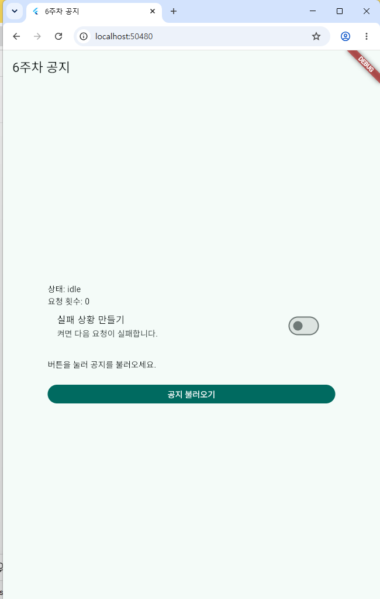
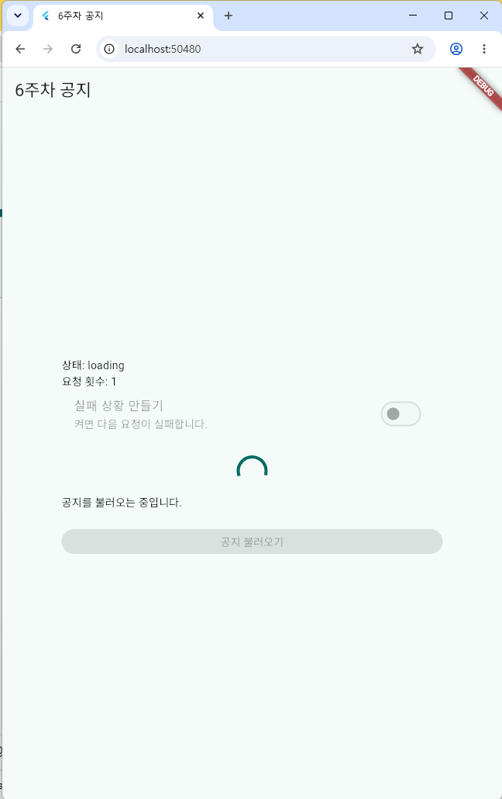
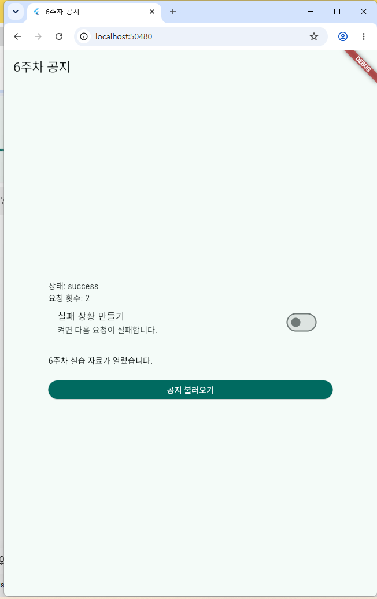
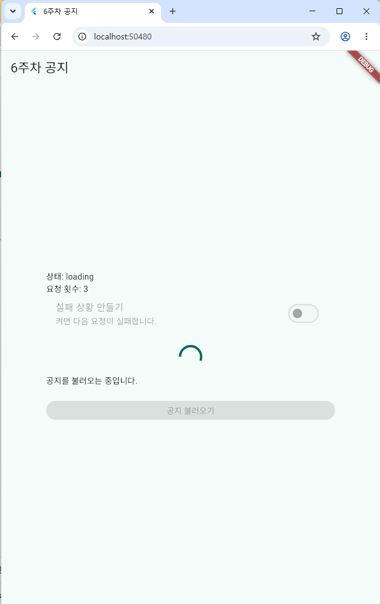
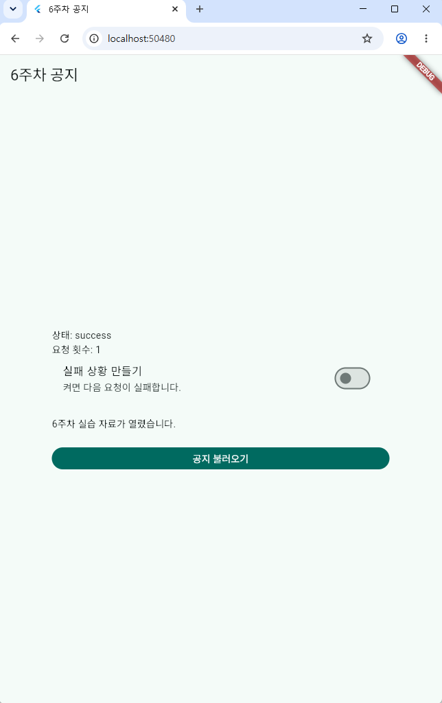
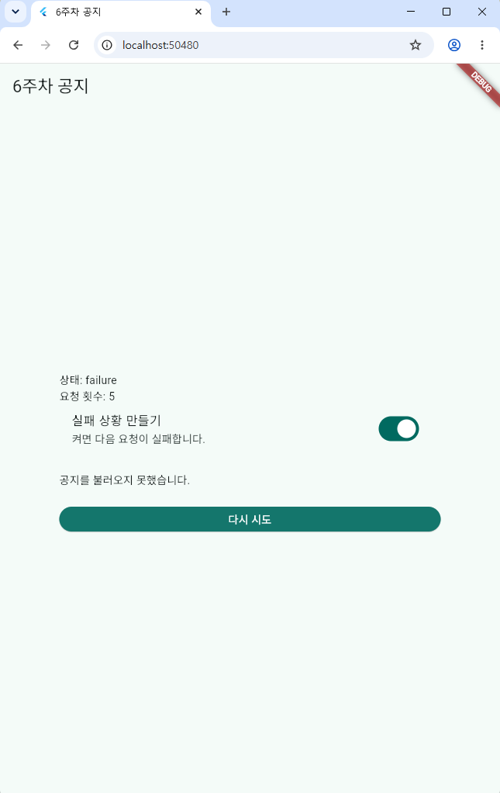
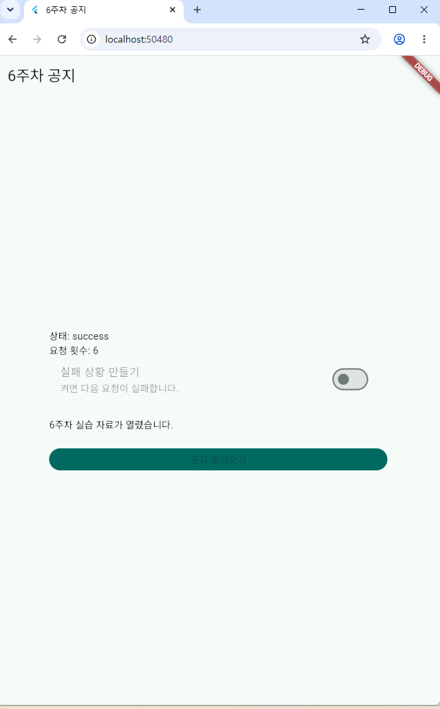
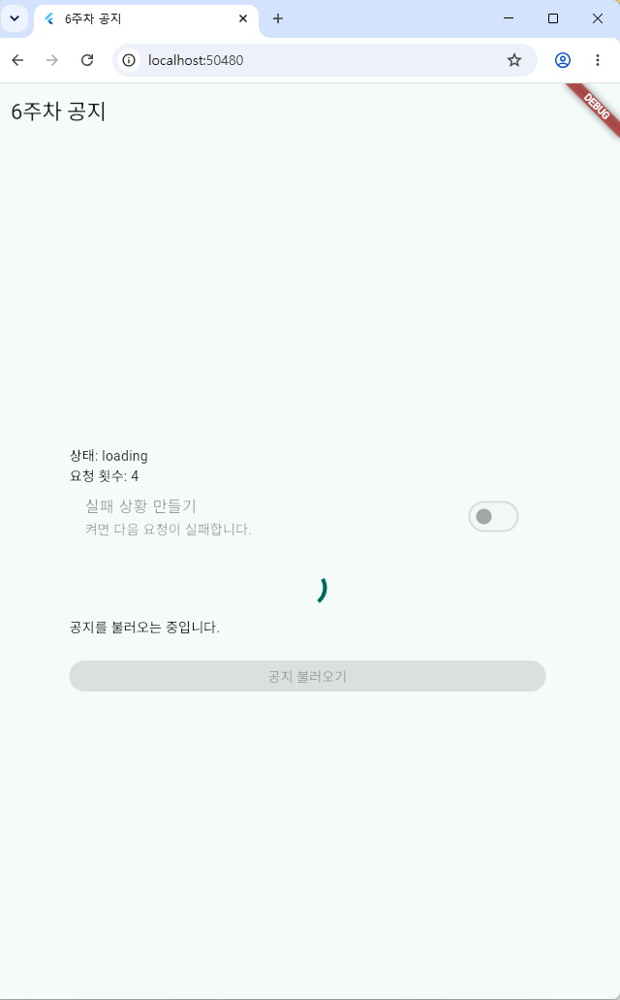
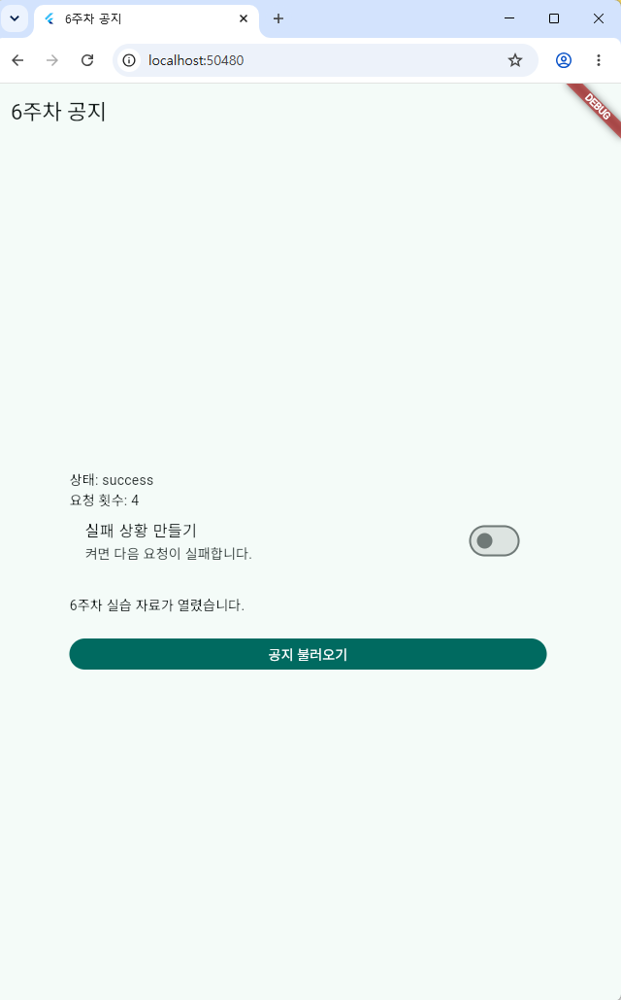

# 6주차 공지 앱 AC 검증표

- 확인일: 2026-10-26
- 실행 명령: `flutter run -d chrome`
- 실행 환경: Windows, Google Chrome 156
- 프로젝트 경로: `C:\Users\412-31\flutter_apps\A\week6_notice`
- 확인 방법: 브라우저에서 직접 조작하고 화면을 캡처함

| AC | 결과 | 실제 관측 | 증거 |
|---|---|---|---|
| AC1 | 통과 | 클릭 즉시 `상태: loading`, 진행 표시, "공지를 불러오는 중입니다." 표시. 버튼과 실패 스위치 잠김. success 상태(요청 횟수 2)에서 재요청하자 로딩 중(요청 횟수 3) 이전 공지 본문이 사라짐 | ac1-loading.png, ac1-before-retry.png, ac1-cleared.png |
| AC2 | 통과 | 약 1초 뒤 `상태: success`, "6주차 실습 자료가 열렸습니다." 표시, 진행 표시 사라짐, 버튼 다시 활성화 | ac2-success.png |
| AC3 | 통과 | 실패 스위치 ON 후 요청 → `상태: failure`, "공지를 불러오지 못했습니다." 표시, 버튼 문구 "다시 시도", 진행 표시 사라짐 | ac3-failure.png |
| AC4 | 통과 | 실패 스위치 OFF 후 "다시 시도" → `상태: success`, 공지 본문 표시, 이전 실패 안내 사라짐, 요청 횟수 5 → 6 | ac4-retry.png |
| AC5 | 통과 | 로딩 중 버튼을 약 5회 연타 → 버튼이 잠겨 있었고 요청 횟수는 3 → 4로 한 번만 증가 | ac5-during.png, ac5-after.png |

## 화면 증거

### 시작 화면 (idle)

### AC1 — 로딩

### AC1 — 재요청 전 (success, 요청 횟수 2)

### AC1 — 재요청 중 이전 결과 제거 (loading, 요청 횟수 3)

### AC2 — 성공

### AC3 — 실패

### AC4 — 재시도 성공

### AC5 — 연타 중

### AC5 — 연타 후

